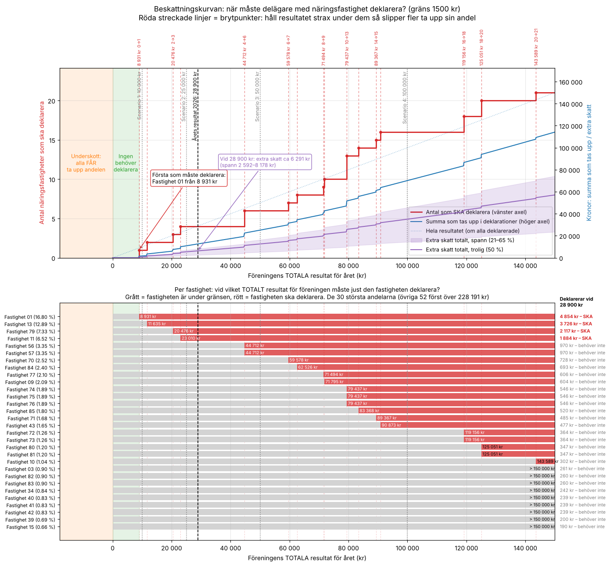
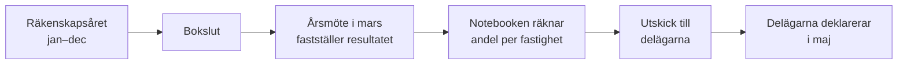
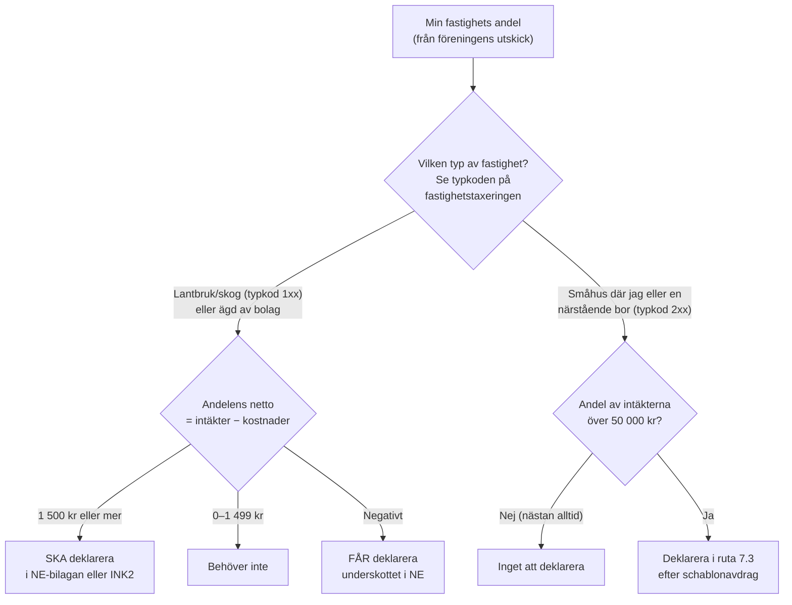

# beskattningFVOF

Ett verktyg för **fiskevårdsområdesföreningar (FVOF)** och andra **delägarbeskattade
samfälligheter**, till exempel viltvårdsområden och vägsamfälligheter. Det räknar ut
vad varje delägarfastighet ska ta upp i deklarationen och visar med en
beskattningskurva när delägarna behöver deklarera.

> [!WARNING]
> **Detta är inte skatterådgivning.** Texten är en **sammanfattning skriven av en
> språkmodell (AI)** och ska bara ses som upplysning om hur reglerna ser ut i
> november 2026. Regler och beloppsgränser ändras. **Se alltid
> [Skatteverket](https://www.skatteverket.se) för aktuella skatteregler.** Varje
> delägare ansvarar själv för sin deklaration.

## Kort om hur det fungerar

Föreningen betalar ingen inkomstskatt själv. I stället äger varje delägarfastighet
en **andel** av föreningen, och fastighetens ägare ska ta upp den andelen av
föreningens intäkter och kostnader i sin egen deklaration. Oftast blir det så små
belopp att ingen behöver deklarera något alls. Den som äger skog eller jordbruk
(en *näringsfastighet*) ska deklarera om fastighetens andel av överskottet är minst
1 500 kr. Ett år med förlust *får* den ägaren välja att ta upp förlusten och minska
sin skatt. Den som bara har ett bostadshus (en *privatbostad*) behöver i praktiken
nästan aldrig göra något. Föreningens uppgift är bara att tala om för varje
fastighet hur stor dess andel av intäkterna och kostnaderna är. Det är vad det här
verktyget räknar ut.

## Beskattningskurvan

Verktygets kärna är **beskattningskurvan**. Den visar vid vilket resultat för
föreningen delägare med näringsfastighet måste börja deklarera, och hur mycket som
då tas upp totalt. Kurvan bygger bara på andelarna, så den kan användas för att
planera: inför en stor utgift, vid budgetering eller när man sätter priset på
fiskekort.



- **Övre diagrammet:** den röda trappan visar hur många som *ska* deklarera vid ett
  visst resultat. Den blå linjen visar hur mycket som tas upp totalt.
  - I det **gröna fältet** behöver ingen deklarera. I exempelbilden gäller det så
    länge resultatet är under 8 931 kr. Gränsen styrs av den största andelen.
  - I det **orange fältet** har föreningen underskott, och alla med näringsfastighet
    *får* ta upp sin andel.
- **Nedre diagrammet:** för varje fastighet visas från vilket resultat just den
  måste deklarera (rött) och var den ligger under gränsen (grått).
- **Scenarier:** i notebooken jämför du egna resultat med listan `SCENARIER`.
  Där finns också ett **reglage** för att prova olika resultat (kräver `ipywidgets`).
- **I utskicket** får varje fastighet kolumnen `naring_deklarera_fran_resultat`.
  Den visar från vilket resultat för föreningen ägaren måste deklarera.

### Årets gång



Årsmötet i mars flyttar inte inkomsten till ett annat år. Verksamhetsåret 2026
deklareras i maj 2027, och en utgift i januari 2027 hör till 2027.

### Behöver jag som delägare deklarera?



| | Näringsfastighet | Privatbostad |
|---|---|---|
| Föreningens kostnader | Ger avdrag | Ger inget avdrag |
| Gräns för att deklarera | Netto ≥ 1 500 kr | Andel av intäkterna > 50 000 kr (schablon 40 000 kr + 20 %) |
| Förlustår | Kan minska skatten på gårdens överskott | Ingen effekt |
| Blankett | NE-bilagan eller INK2 | Ruta 7.3 (ränta i 7.2) |

## Så använder du verktyget

Du behöver **bara några summor ur bokslutets resultaträkning**, inga enskilda
transaktioner.

1. **`data/andelar.csv`**: ett andelstal per rad, med komma eller punkt som
   decimaltecken. Filen i repot är ett exempel. Byt ut den mot er förenings
   andelar. Vill du ha med fler uppgifter använder du en tabell med semikolon och
   rubrikrad:

   ```
   fastighet;andel;typ
   Byn 1:3;0,1679;naring
   Byn 2:7;0,0652;privat
   Byn 4:1;0,0335;
   ```

   - `fastighet` är frivillig.
   - `typ` är frivillig och kan vara `naring`, `privat` eller tom (okänd). Typen
     ger en mer rättvisande bild. Privatbostäder räknas inte i beskattningskurvan,
     eftersom de bara behöver deklarera om andelen av intäkterna är över cirka
     50 000 kr. Om några av de största andelarna är privatbostäder hamnar alltså
     fler under gränsen. Okänd typ räknas som näring, vilket är det strängaste
     fallet, och utskicket visar då utfallet för båda typerna.
2. **Bokslutets siffror** fyller du i direkt i notebookens första kodcell, i
   `BOKSLUT`. Ta dem från resultaträkningen:

   ```python
   AR = 2026
   BOKSLUT = {
       "intakter": 95000,        # summa rörelseintäkter (fiskekort, bidrag m.m.)
       "kostnader": 58000,       # summa rörelsekostnader inkl. avskrivningar
       "ranteintakter": 400,     # finansiella intäkter, behövs för KU73-kontrollen
       "ranteutgifter": 0,       # finansiella kostnader
       "varav_uttaxering": 8500, # avgifter från delägarna som ingår i intäkterna, räknas bort
   }
   ```

   **Intäkter och kostnader krävs.** Delägare med näringsfastighet ska ta upp sin
   andel av intäkterna och sin andel av kostnaderna var för sig, så utskicket
   visar båda. Resultatet räknas fram ur dem.
3. **Frivilligt: `data/agare.csv`** med ägarna inom varje fastighet. Det ger en
   sammanställning per person. Fastighetsnamnen måste vara desamma som i
   `andelar.csv`, och fastigheter utan namn heter *Fastighet 01*, *Fastighet 02*
   och så vidare. Utelämnas `agarandel` delas fastigheten lika. En person kan
   äga flera fastigheter.

   ```
   fastighet;agare;agarandel
   Byn 1:3;Anna Andersson;1/2
   Byn 1:3;Bo Berg;1/2
   Byn 2:7;Skog AB;
   ```
4. Kör alla celler. Beskattningskurvan sparas i `utdata/beskattningskurva.png`,
   underlaget per fastighet i `utdata/underlag_<år>.csv` och sammanställningen
   per ägare i `utdata/per_person_<år>.csv`.

**Gränsen gäller fastighetens andel av föreningens resultat.** Gränsen på 1 500 kr
jämförs med *fastighetens andel av föreningens* intäkter minus kostnader. Ägarens
egna kostnader räknas inte. Den gäller per fastighet, inte per ägare. Har en
fastighet flera ägare delar de på fastighetens andel, men det ändrar inte om
fastigheten hamnar över eller under gränsen. Det som påverkar är fastighetens
**typ** (se ovan) och föreningens resultat. Den som ändå deklarerar andelen tar
upp den i sin näringsverksamhet tillsammans med sina egna intäkter och kostnader.

Kräver Python 3 och `matplotlib`. `ipywidgets` behövs bara för reglaget.

**Moms:** ta beloppen direkt från resultaträkningen. Där är de redan rätt. Hos en
momsregistrerad förening är de utan moms. Hos en förening som inte är
momsregistrerad ingår momsen i kostnaderna, och så ska det vara.

**Vad blir förenklat?** Alla intäkter behandlas lika, och bokslutets avskrivningar
används. För näringsfastigheter blir det rätt. Den som vill göra något annat,
till exempel en egen avskrivningsplan, får räkna själv utifrån sin andel. För
privatbostäder räknas alla intäkter som upplåtelseintäkter. Det kan ge något för
höga siffror, men i en normalstor förening hamnar de ändå långt under gränsen.

## Uppskattad extra skatt

Notebooken summerar hur mycket varje ägare ska ta upp och uppskattar vad det kostar
i skatt, både per ägare och för alla medlemmar tillsammans. Eftersom skatten beror
på varje ägares egen situation visas den som ett **spann**. Satserna ändras i
`SKATTESATS`.

| Nivå | Sats | Ungefär vem |
|---|---|---|
| Låg | 20,6 % | Aktiebolag (bolagsskatt). Den som har underskott i sin NE betalar 0 kr just det året |
| Trolig | 50 % | Privatperson med näringsverksamhet: kommunalskatt ca 32 % + särskild löneskatt 24,26 % (passiv) eller egenavgifter 28,97 % (aktiv), efter schablonavdrag |
| Hög | 65 % | Som trolig, men med statlig inkomstskatt 20 % över skiktgränsen |
| Privatbostad | 30 % | Inkomst av kapital |

Ett förlustår visas i stället hur mycket delägarna *kan* sänka sin skatt om de
väljer att ta upp underskottet. Beskattningskurvans scenariotabell visar också den
totala extra skatten för varje scenario.

## Bra att veta

- **Driftsbidrag och utdelning.** Avgifter som delägarna betalar till föreningen är
  inte avdragsgilla för dem. Utdelning från föreningen är skattefri. Ingen av dem
  ska därför räknas med.
- **Avskrivningar.** Huvudregeln är att köpta tjänster och undersökningar dras av
  direkt det år de görs, till exempel en fiskevårdsplan från en konsult eller ett
  provfiske. Det finns ingen regel om 10 eller 5 år för sådana utgifter. Inventarier
  som båt, motor och redskap skrivs ofta av på 5 år. De får dras av direkt om de
  kostar mindre än ett halvt prisbasbelopp, alltså 29 800 kr år 2027 utan moms.
  Stäm av med revisorn om ni vill fördela en tjänst över flera år.
- **Moms.** Fiskekort är momspliktiga med 25 % moms när föreningen är
  momsregistrerad, vilket krävs över 120 000 kr i omsättning per år. Momsen är då
  föreningens och syns inte i delägarnas underlag.
- **Bolag med brutet räkenskapsår.** Föreningen lämnar siffror för sitt eget år.
  Bolagets revisor avgör vilket år bolaget tar upp dem.
- **KU73** gäller bara **föreningens ränteintäkter**, inte fiskekort och inte
  utdelning till medlemmarna. Den behövs bara om en privatbostads andel av räntan
  överstiger 1 500 kr. Notebooken kontrollerar det. KU73 lämnas digitalt senast
  31 januari, med ägarens personnummer. Har fastigheten flera ägare delas beloppet
  lika på en KU73 per ägare.
- **Fastighetstyp.** Föreningen behöver inte hålla reda på vilken typ av fastighet
  varje delägare har. Underlaget visar utfallet för båda typerna, och delägaren
  läser det som gäller för hen.

## Källor

- [Skatteverket: Så deklarerar du som delägare i en samfällighet](https://skatteverket.se/foreningar/deklarera/sadeklarerarduatensamfallighet/sadeklarerardusomdelagareiensamfallighet.4.1c68351d170ce5545273d9b.html)
- [Skatteverket: Så deklarerar du åt en samfällighet](https://skatteverket.se/foreningar/deklarera/sadeklarerarduatensamfallighet.4.70ac421612e2a997f85800044871.html)
- [Skatteverket: Kontrolluppgift KU73](https://www.skatteverket.se/foretag/skatterochavdrag/kontrolluppgifter/kontrolluppgiftomutdelningmmtilldelagareiensamfallighetku73.4.339cd9fe17d1714c07713c1.html)
- [Skatteverket: Typkoder för fastigheter](https://skatteverket.se/foretag/skatterochavdrag/fastighet/fastighetstaxering/typkoder.4.3f4496fd14864cc5ac9126d.html)
- [Vattenägarna: Momsplikten](https://www.vattenagarna.se/momsplikten/)
- Inkomstskattelagen (1999:1229) 15 kap. 10 §, mervärdesskattelagen (2023:200) 10 kap.

Licens: GPL-3.0, se `LICENSE`.
