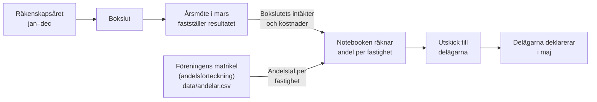
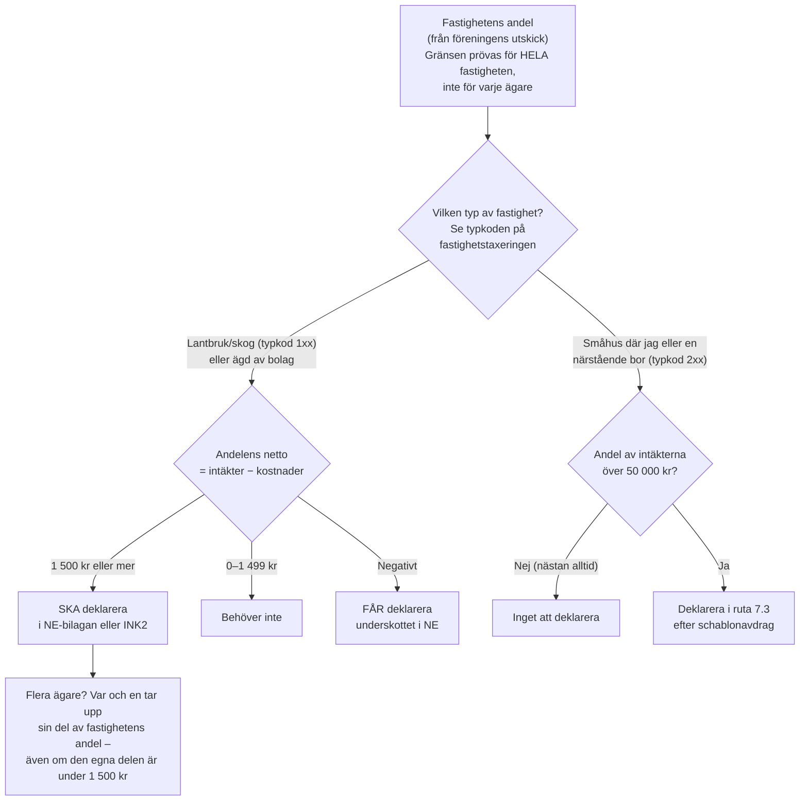
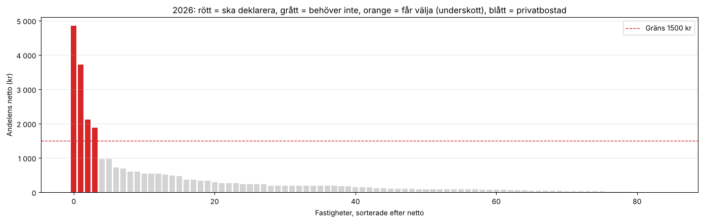

# beskattningFVOF

Ett verktyg för **fiskevårdsområdesföreningar (FVOF)** och andra **delägarbeskattade
samfälligheter**, till exempel viltvårdsområden och vägsamfälligheter. Det räknar ut
vad varje delägarfastighet ska ta upp i deklarationen och visar med en
beskattningskurva när delägarna behöver deklarera.

> [!WARNING]
> **Detta är inte skatterådgivning.** Texten är en **sammanfattning skriven av en
> språkmodell (AI)** och ska bara ses som upplysning om hur reglerna ser ut i
> november 2026. Regler och beloppsgränser ändras. **Se alltid
> [Skatteverket](https://www.skatteverket.se) för aktuella skatteregler.** Varje
> delägare ansvarar själv för sin deklaration.

**▶ Kör verktyget direkt i webbläsaren:** <https://huggek.github.io/beskattningFVOF/lab/index.html?path=beskattning.ipynb>

## Kort om hur det fungerar

Föreningen betalar ingen inkomstskatt själv. I stället äger varje delägarfastighet
en **andel** av föreningen, och fastighetens ägare ska ta upp den andelen av
föreningens intäkter och kostnader i sin egen deklaration. Oftast blir det så små
belopp att ingen behöver deklarera något alls. Den som äger skog eller jordbruk
(en *näringsfastighet*) ska deklarera om fastighetens andel av överskottet är minst
1 500 kr. Ett år med förlust *får* den ägaren välja att ta upp förlusten och minska
sin skatt. Den som bara har ett bostadshus (en *privatbostad*) behöver i praktiken
nästan aldrig göra något. Föreningens uppgift är bara att tala om för varje
fastighet hur stor dess andel av intäkterna och kostnaderna är. Det är vad det här
verktyget räknar ut.

### Exempel: från indata till utskick

**Indata 1: `data/andelar.csv`.** Bara `andel` krävs.

```
fastighet;andel;typ
Byn 1:3;0,167971461;naring
Byn 2:7;0,128922348;privat
Byn 4:1;0,065191174;naring
Byn 5:2;0,033548309;
```

**Indata 2: bokslutets siffror**, ifyllda i notebooken:

```python
BOKSLUT = {"intakter": 95000, "kostnader": 58000, "ranteintakter": 400,
           "ranteutgifter": 0, "varav_uttaxering": 8500}
# → föreningens totala resultat: 86 900 − 58 000 = 28 900 kr
```

**Resultat per fastighet** (andel × föreningens totala resultat), utdrag ur
`utdata/underlag_2026.csv`:

| Fastighet | Andel | Intäkter | Kostnader | Netto | Status | Måste deklarera från föreningsresultat |
|---|---|---|---|---|---|---|
| Byn 1:3 | 16,80 % | 14 597 kr | 9 742 kr | **4 854 kr** | SKA deklarera (har fastigheten två ägare tar båda upp 2 427 kr) | 8 931 kr |
| Byn 2:7 | 12,89 % | 11 203 kr | 7 477 kr | 3 726 kr | Privatbostad, inget att deklarera | – |
| Byn 4:1 | 6,52 % | 5 665 kr | 3 781 kr | **1 884 kr** | SKA deklarera | 23 010 kr |
| Byn 5:2 | 3,35 % | 2 915 kr | 1 946 kr | 970 kr | Behöver inte (under 1 500 kr) | 44 712 kr |

## Beskattningskurvan

Verktygets kärna är **beskattningskurvan**. Den visar vid vilket resultat för
föreningen delägare med näringsfastighet måste börja deklarera, och hur mycket som
då tas upp totalt. Kurvan bygger bara på andelarna, så den kan användas för att
planera: inför en stor utgift, vid budgetering eller när man sätter priset på
fiskekort.


- **Övre diagrammet:** den röda trappan visar hur många som *ska* deklarera vid ett
  visst resultat. Den blå linjen visar hur mycket som tas upp totalt. Det **lila
  fältet** visar den uppskattade **extra skatten totalt för medlemmarna** vid varje
  resultatnivå, som ett spann från låg till hög skattesats. Den lila linjen är den
  troliga nivån. Vid årets resultat skrivs beloppet ut.
  - I det **gröna fältet** behöver ingen deklarera. I exempelbilden gäller det så
    länge resultatet är under 8 931 kr. Gränsen styrs av den största andelen.
  - I det **orange fältet** har föreningen underskott, och alla med näringsfastighet
    *får* ta upp sin andel.
- **Röda streckade linjer** markerar **brytpunkterna**, alltså de resultat där
  ytterligare fastigheter måste börja deklarera. Etiketten visar resultatet och
  hur antalet ändras, till exempel `44 712 kr 4→6`. Om föreningen kan styra årets
  resultat, genom att tidigarelägga en utgift eller sätta fiskekortspriset, slipper
  fler deklarera om resultatet hamnar strax *under* en brytpunkt. Notebooken
  skriver också ut en tabell med alla intervall och visar hur långt årets resultat
  ligger från närmaste brytpunkt.
- **Nedre diagrammet:** den vågräta axeln är **föreningens totala resultat**, samma
  axel som i diagrammet ovan, så brytpunkterna hamnar rakt under varandra.
  För varje fastighet visar grått de resultat där fastigheten är under gränsen,
  och rött de resultat där den måste deklarera. Kolumnen till höger visar **hur
  mycket varje fastighet skulle deklarera vid årets resultat** (andel × resultat)
  och om den måste.
- **Scenarier:** i notebooken jämför du egna resultat med listan `SCENARIER`.
- **I utskicket** får varje fastighet kolumnen `naring_deklarera_fran_resultat`.
  Den visar från vilket resultat för föreningen ägaren måste deklarera.

### Årets gång



Notebooken behöver två saker: **föreningens matrikel**, alltså förteckningen över
delägarfastigheter och andelstal, i `data/andelar.csv`, och **bokslutets
intäkter och kostnader**. Uppdatera matrikeln när fastigheter byter ägare eller
delas. Årsmötet i mars flyttar inte inkomsten till ett annat år. Verksamhetsåret 2026
deklareras i maj 2027, och en utgift i januari 2027 hör till 2027.

### Behöver jag som delägare deklarera?



**Gränsen gäller fastigheten, inte varje ägare.** Enligt 15 kap. 10 § IL behöver
*fastighetens andel* inte tas upp om den understiger 1 500 kr. Prövningen görs alltså
för hela fastighetens andel. Äger två personer en fastighet med netto 2 400 kr ska
båda ta upp 1 200 kr var, trots att var och ens del är under 1 500 kr. Är
fastighetens netto 1 400 kr behöver ingen av dem ta upp något.

| | Näringsfastighet | Privatbostad |
|---|---|---|
| Föreningens kostnader | Ger avdrag | Ger inget avdrag |
| Gräns för att deklarera | Netto ≥ 1 500 kr | Andel av intäkterna > 50 000 kr (schablon 40 000 kr + 20 %) |
| Förlustår | Kan minska skatten på gårdens överskott | Ingen effekt |
| Blankett | NE-bilagan eller INK2 | Ruta 7.3 (ränta i 7.2) |

## Så använder du verktyget

Du behöver **bara några summor ur bokslutets resultaträkning**, inga enskilda
transaktioner.

1. **`data/andelar.csv`**: ett andelstal per rad, med komma eller punkt som
   decimaltecken. Filen i repot är ett exempel. Byt ut den mot er förenings
   andelar. Vill du ha med fler uppgifter använder du en tabell med semikolon och
   rubrikrad:

   ```
   fastighet;andel;typ
   Byn 1:3;0,1679;naring
   Byn 2:7;0,0652;privat
   Byn 4:1;0,0335;
   ```

   - `fastighet` är frivillig.
   - `typ` är frivillig och kan vara `naring`, `privat` eller tom (okänd). Typen
     ger en mer rättvisande bild. Privatbostäder räknas inte i beskattningskurvan,
     eftersom de bara behöver deklarera om andelen av intäkterna är över cirka
     50 000 kr. Om några av de största andelarna är privatbostäder hamnar alltså
     fler under gränsen. Okänd typ räknas som näring, vilket är det strängaste
     fallet, och utskicket visar då utfallet för båda typerna.
2. **Bokslutets siffror** fyller du i direkt i notebookens första kodcell, i
   `BOKSLUT`. Ta dem från resultaträkningen:

   ```python
   AR = 2026
   BOKSLUT = {
       "intakter": 95000,        # summa rörelseintäkter (fiskekort, bidrag m.m.)
       "kostnader": 58000,       # summa rörelsekostnader inkl. avskrivningar
       "ranteintakter": 400,     # finansiella intäkter, behövs för KU73-kontrollen
       "ranteutgifter": 0,       # finansiella kostnader
       "varav_uttaxering": 8500, # avgifter från delägarna som ingår i intäkterna, räknas bort
   }
   ```

   **Intäkter och kostnader krävs.** Delägare med näringsfastighet ska ta upp sin
   andel av intäkterna och sin andel av kostnaderna var för sig, så utskicket
   visar båda. Resultatet räknas fram ur dem.
3. Kör alla celler. Beskattningskurvan sparas i `utdata/beskattningskurva.png` och
   underlaget per fastighet i `utdata/underlag_<år>.csv`.

**Gränsen gäller fastighetens andel av föreningens resultat.** Gränsen på 1 500 kr
jämförs med *fastighetens andel av föreningens* intäkter minus kostnader. Ägarens
egna kostnader räknas inte. Den gäller per fastighet, inte per ägare. Har en
fastighet flera ägare delar de på fastighetens andel, men det ändrar inte om
fastigheten hamnar över eller under gränsen. Det som påverkar är fastighetens
**typ** (se ovan) och föreningens resultat. Den som ändå deklarerar andelen tar
upp den i sin näringsverksamhet tillsammans med sina egna intäkter och kostnader.

Lokalt kräver notebooken Python 3 och `matplotlib` (`pip install -r requirements.txt`).

### Kör i webbläsaren utan installation

[](https://huggek.github.io/beskattningFVOF/lab/index.html?path=beskattning.ipynb)

- **JupyterLite på GitHub Pages** kör hela notebooken i webbläsaren och startar på
  några sekunder: **<https://huggek.github.io/beskattningFVOF/lab/index.html?path=beskattning.ipynb>**.
  Inget körs på någon server, och era siffror stannar i webbläsaren. Byt ut
  `data/andelar.csv` genom att dra in er egen matrikel i filbläddraren till vänster,
  fyll i `BOKSLUT` och välj *Run → Run All Cells*. Ändringar sparas i webbläsaren.
  Ladda ner `utdata/` (högerklicka → *Download*) när du är klar. Sidan byggs
  automatiskt av GitHub Actions (`.github/workflows/jupyterlite.yml`) vid varje
  ändring på `main`.

**Moms:** ta beloppen direkt från resultaträkningen. Där är de redan rätt. Hos en
momsregistrerad förening är de utan moms. Hos en förening som inte är
momsregistrerad ingår momsen i kostnaderna, och så ska det vara.

**Vad blir förenklat?** Alla intäkter behandlas lika, och bokslutets avskrivningar
används. För näringsfastigheter blir det rätt. Den som vill göra något annat,
till exempel en egen avskrivningsplan, får räkna själv utifrån sin andel. För
privatbostäder räknas alla intäkter som upplåtelseintäkter. Det kan ge något för
höga siffror, men i en normalstor förening hamnar de ändå långt under gränsen.

## Det här visar notebooken

Exemplen nedan kommer från en körning med exempelfilen i repot och exempelbokslutet
(intäkter 95 000 kr, kostnader 58 000 kr, uttaxering 8 500 kr, ränta 400 kr).

### Avsnitt 2: Inläsning

En kontroll av att matrikeln och bokslutet har lästs in rätt:

```text
85 delägarfastigheter, summa andelstal 1.000000
Fastighetstyp: okänd 85 st

Föreningen 2026:  intäkter 86 900 kr  –  kostnader 58 000 kr  =  resultat 28 900 kr
  (uttaxering 8 500 kr är borträknad ur intäkterna)
```

### Avsnitt 3: Beskattningskurvan

**Scenariotabell.** Årets resultat jämförs med resultaten i `SCENARIER`:

```text
                         Resultat  Ska deklarera  Under gränsen  Tas upp totalt   Extra skatt totalt, trolig (spann)
Årets resultat 2026        28 900              4             81       12 581 kr          6 291 kr (2 592–8 178 kr)
Scenario 1                 10 000              1             84        1 680 kr            840 kr (346–1 092 kr)
Scenario 2                 25 000              4             81       10 884 kr          5 442 kr (2 242–7 074 kr)
Scenario 3                 50 000              6             79       25 122 kr         12 561 kr (5 175–16 329 kr)
Scenario 4                100 000             16             69       70 142 kr         35 071 kr (14 449–45 592 kr)
```

**Planeringstabell med brytpunkter.** Varje resultatintervall, hur många som ska
deklarera och vilka fastigheter som tillkommer (de första raderna):

```text
  Föreningens resultat     Ska deklarera   Tillkommer vid intervallets början
  0 – 8 930 kr                         0
  8 931 – 11 634 kr                    1   + Fastighet 01
  11 635 – 20 475 kr                   2   + Fastighet 13
  20 476 – 23 009 kr                   3   + Fastighet 79
  23 010 – 44 711 kr                   4   + Fastighet 11
  44 712 – 59 577 kr                   6   + Fastighet 56, Fastighet 57
  …

Årets resultat 28 900 kr ligger 5 890 kr över brytpunkten 23 010 kr. Under 23 010 kr hade 1 färre behövt deklarera.
Nästa brytpunkt är 44 712 kr (15 812 kr bort) – då tillkommer 2 till.
```

**Diagrammet** är bilden högst upp i README:n, med två delar:

| Del | Visar |
|---|---|
| Övre: beskattningskurvan | Röd trappa med antal som ska deklarera. Blå linje med summa som tas upp. Lila fält med extra skatt (spann) och lila linje med trolig skatt. Röda streckade linjer vid brytpunkterna. Linjer för årets resultat och scenarierna. Grönt fält där ingen behöver deklarera och orange fält för underskott. |
| Nedre: per fastighet | De 30 största andelarna. Grått där fastigheten är under gränsen och rött där den ska deklarera. Kolumnen till höger visar vad varje fastighet deklarerar vid årets resultat. |

### Avsnitt 4: Underlag per fastighet

**Tabell för alla fastigheter** (utdrag):

```text
Fastighet        Typ      Andel %  Intäkter  Kostnader    Netto  Status
Fastighet 01     okänd     16.797    14 597      9 742    4 854  Näring: SKA deklarera / Privat: Inget att deklarera
Fastighet 02     okänd      0.176       153        102       51  Näring: Behöver inte / Privat: Inget att deklarera
…
Sammanställning:
  okänd   Näring: Behöver inte / Privat: Inget att deklarera            81 st
  okänd   Näring: SKA deklarera / Privat: Inget att deklarera            4 st

KU73 behövs inte: största andel av räntan är 67 kr (gräns 1500 kr).
```

När `typ` är angiven i matrikeln visas bara status för den typen.

**Stapeldiagram** med varje fastighets netto, sorterat från störst till minst.
Rött = ska deklarera, grått = behöver inte, orange = får välja (underskott),
blått = privatbostad.



### Avsnitt 5: Uppskattad extra skatt

```text
Fastighet           Ska ta upp  Skatt trolig   Spann
Fastighet 01          4 854 kr      2 427 kr   1 000–3 155 kr
Fastighet 13          3 726 kr      1 863 kr   768–2 422 kr
Fastighet 79          2 117 kr      1 059 kr   436–1 376 kr
Fastighet 11          1 884 kr        942 kr   388–1 225 kr

Alla medlemmar tillsammans: ca 6 291 kr i extra skatt (spann 2 592–8 178 kr).
  4 av 85 fastigheter berörs → i snitt 1 573 kr per berörd fastighet (648–2 044 kr).
```

Ett förlustår visas i stället hur mycket delägarna kan sänka sin skatt om de tar
upp underskottet.

### Filer i mappen `utdata`

| Fil | Innehåll |
|---|---|
| `beskattningskurva.png` | Diagrammet från avsnitt 3 |
| `underlag_<år>.csv` | En rad per fastighet. Öppnas direkt i Excel (semikolon och decimalkomma). |

Kolumner i `underlag_<år>.csv`:

| Kolumn | Betyder |
|---|---|
| `fastighet`, `typ`, `andel` | Från matrikeln |
| `intakter`, `kostnader`, `netto` | Fastighetens andel av föreningens intäkter och kostnader, och skillnaden. Det är beloppen som förs in i NE-bilagan. |
| `status` | Utfallet för den angivna typen (eller för båda om typen är okänd) |
| `om_naringsfastighet` | `SKA deklarera`, `Behöver inte` eller `FÅR välja (underskott)` |
| `om_privatbostad`, `privat_ruta_7_3`, `privat_ruta_7_2`, `privat_ruta_8_1` | Utfallet om fastigheten är en privatbostad, och beloppen per ruta |
| `ku73_om_privat` | Belopp för KU73 om fastigheten är en privatbostad (oftast 0) |
| `naring_deklarera_fran_resultat` | Från vilket totalt resultat för föreningen fastigheten måste deklarera |

## Uppskattad extra skatt

Notebooken summerar hur mycket varje fastighet ska ta upp och uppskattar vad det
kostar i skatt, både per fastighet och för alla medlemmar tillsammans. Eftersom
skatten beror på varje ägares egen situation visas den som ett **spann**. Satserna ändras i
`SKATTESATS`.

| Nivå | Sats | Ungefär vem |
|---|---|---|
| Låg | 20,6 % | Aktiebolag (bolagsskatt). Den som har underskott i sin NE betalar 0 kr just det året |
| Trolig | 50 % | Privatperson med näringsverksamhet: kommunalskatt ca 32 % + särskild löneskatt 24,26 % (passiv) eller egenavgifter 28,97 % (aktiv), efter schablonavdrag |
| Hög | 65 % | Som trolig, men med statlig inkomstskatt 20 % över skiktgränsen |
| Privatbostad | 30 % | Inkomst av kapital |

Ett förlustår visas i stället hur mycket delägarna *kan* sänka sin skatt om de
väljer att ta upp underskottet. Beskattningskurvans scenariotabell visar också den
totala extra skatten för varje scenario.

## Bra att veta

- **Driftsbidrag och utdelning.** Avgifter som delägarna betalar till föreningen är
  inte avdragsgilla för dem. Utdelning från föreningen är skattefri. Ingen av dem
  ska därför räknas med.
- **Avskrivningar.** Huvudregeln är att köpta tjänster och undersökningar dras av
  direkt det år de görs, till exempel en fiskevårdsplan från en konsult eller ett
  provfiske. Det finns ingen regel om 10 eller 5 år för sådana utgifter. Inventarier
  som båt, motor och redskap skrivs ofta av på 5 år. De får dras av direkt om de
  kostar mindre än ett halvt prisbasbelopp, alltså 29 800 kr år 2027 utan moms.
  Stäm av med revisorn om ni vill fördela en tjänst över flera år.
- **Moms.** Fiskekort är momspliktiga med 25 % moms när föreningen är
  momsregistrerad, vilket krävs över 120 000 kr i omsättning per år. Momsen är då
  föreningens och syns inte i delägarnas underlag.
- **Bolag med brutet räkenskapsår.** Föreningen lämnar siffror för sitt eget år.
  Bolagets revisor avgör vilket år bolaget tar upp dem.
- **KU73** gäller bara **föreningens ränteintäkter**, inte fiskekort och inte
  utdelning till medlemmarna. Den behövs bara om en privatbostads andel av räntan
  överstiger 1 500 kr. Notebooken kontrollerar det. KU73 lämnas digitalt senast
  31 januari, med ägarens personnummer. Har fastigheten flera ägare delas beloppet
  lika på en KU73 per ägare.
- **Fastighetstyp.** Föreningen behöver inte hålla reda på vilken typ av fastighet
  varje delägare har. Underlaget visar utfallet för båda typerna, och delägaren
  läser det som gäller för hen.

## Källor

- [Skatteverket: Så deklarerar du som delägare i en samfällighet](https://skatteverket.se/foreningar/deklarera/sadeklarerarduatensamfallighet/sadeklarerardusomdelagareiensamfallighet.4.1c68351d170ce5545273d9b.html)
- [Skatteverket: Så deklarerar du åt en samfällighet](https://skatteverket.se/foreningar/deklarera/sadeklarerarduatensamfallighet.4.70ac421612e2a997f85800044871.html)
- [Skatteverket: Kontrolluppgift KU73](https://www.skatteverket.se/foretag/skatterochavdrag/kontrolluppgifter/kontrolluppgiftomutdelningmmtilldelagareiensamfallighetku73.4.339cd9fe17d1714c07713c1.html)
- [Skatteverket: Typkoder för fastigheter](https://skatteverket.se/foretag/skatterochavdrag/fastighet/fastighetstaxering/typkoder.4.3f4496fd14864cc5ac9126d.html)
- [Vattenägarna: Momsplikten](https://www.vattenagarna.se/momsplikten/)
- Inkomstskattelagen (1999:1229) 15 kap. 10 §, mervärdesskattelagen (2023:200) 10 kap.

Licens: GPL-3.0, se `LICENSE`.
